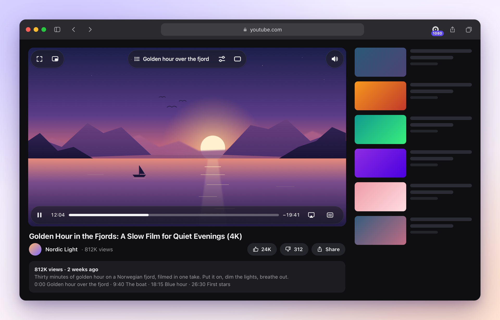
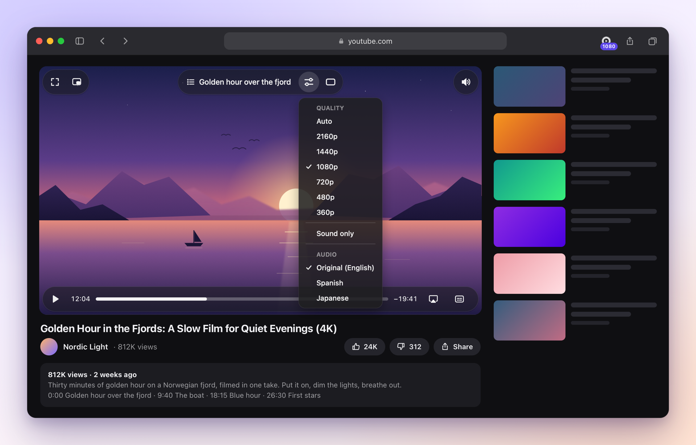
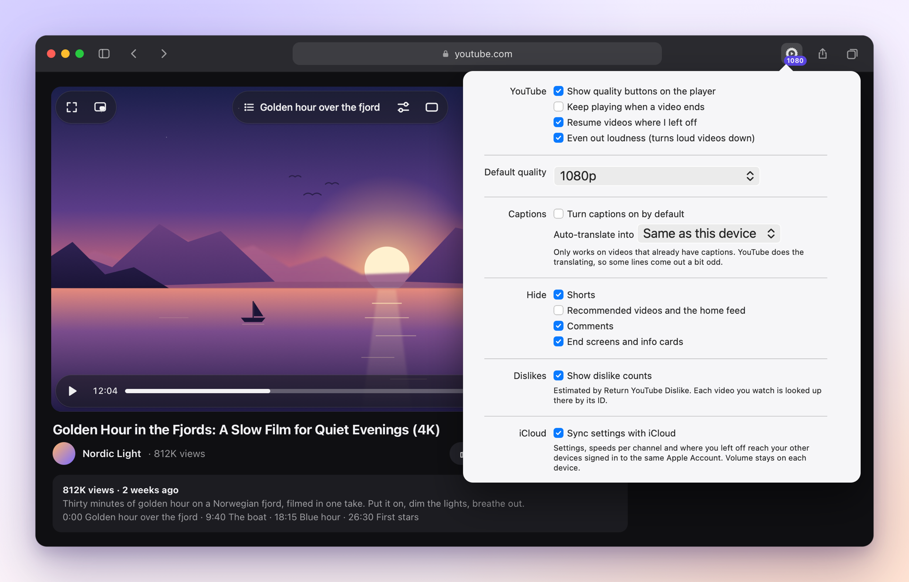

# Spelare

**YouTube, the way Safari plays video.** Spelare swaps YouTube's player for Safari's own: the same
smooth, battery-friendly player you get everywhere else on your Mac, with Picture in Picture, AirPlay and
your media keys working the way they should. No ads, and nothing to set up.

  
  &nbsp;
  

Free, open source, and signed and notarized by Apple. Works on macOS 12 or later.

## Why Spelare

YouTube's player is a website's player: a heavy layer of scripts that feeds video in piece by piece,
with its own controls in the way of Safari's. Spelare hands YouTube's own streams straight to Safari's
native player instead, the way Apple's apps play video. Less code running, and everything that makes
video on a Mac nice comes back.

## What you get

- **Safari's player.** Native controls, full screen, Picture in Picture and AirPlay that just work, and
  Now Playing with your keyboard's media keys.
- **No ads.** Videos start right away, without pre-rolls or mid-roll breaks.
- **Quality on your terms.** Pick any quality up to 4K, or Sound only for podcasts and music, right from
  the player. Set a default, or change it on the fly with `Q`.
- **Chapters.** See which chapter you're in and jump to any other.
- **Picks up where you left off.** Videos resume where you stopped. Volume is remembered, and so is
  your playback speed, per channel: podcasts at 1.5×, music at 1×.
- **Even loudness.** Loud videos are turned down to a comfortable, even level.
- **Your language.** Captions with auto-translation, and dubbed audio tracks when a video has them.
- **A calmer YouTube.** Optionally hide Shorts, recommendations, comments and end screens.
- **Dislike counts.** Optionally see them again, estimated by Return YouTube Dislike.
- **In sync.** Settings, per-channel speeds and where you left off follow you between your devices
  through iCloud.

<table>
  <tr>
    <td width="50%"></td>
    <td width="50%"></td>
  </tr>
  <tr>
    <td align="center"><b>Quality and audio</b>, right on the video</td>
    <td align="center"><b>Settings</b>, a click away in Safari's toolbar</td>
  </tr>
</table>

### Keyboard shortcuts

| Key | Does |
|---|---|
| `Space` or `K` | Play or pause |
| `J` / `L` | Back or forward 10 seconds |
| `←` / `→` | Back or forward 5 seconds |
| `,` / `.` | One frame back or forward, while paused |
| `<` / `>` | Slower or faster |
| `Q` / `Shift-Q` | Higher or lower quality |
| `F` | Full screen |
| `I` | Picture in Picture |
| `T` | Theater mode |
| `C` | Captions |
| `M` | Mute |

## Install

1. [Download **Spelare.dmg**](https://github.com/klppl/spelare/releases/latest/download/Spelare.dmg)
   and drag Spelare into Applications.
2. Open Spelare once, so Safari finds the extension.
3. In Safari, choose **Settings ▸ Extensions**, turn on **Spelare**, and allow it on youtube.com.

That's it. Open any YouTube video and Spelare takes over. Its settings are under the Spelare button in
Safari's toolbar.

Spelare keeps itself up to date: when you open the app, it checks for a new version.

## Privacy

Spelare has no servers, no accounts and no tracking. It talks to YouTube, as YouTube's own player
would. The one exception is dislike counts, which are off by default: turn them on, and each video's ID
is looked up at Return YouTube Dislike. If you sync with iCloud, your settings go through your own
iCloud account.

## iPhone and iPad

Spelare runs on iPhone and iPad too, including playing on with the screen locked. It isn't available
to download for them yet.

## For developers

Spelare is a Manifest V3 Safari web extension in a small native app. [DEVELOPMENT.md](DEVELOPMENT.md)
covers how it works, the code layout and how to build it; [TESTING.md](TESTING.md) and
[RELEASING.md](RELEASING.md) cover testing and releases.

## License

Spelare is released under the [Lagom License](LICENSE): use it, change it and share it as you like, as
long as you keep the copyright notice and the license. The bundled challenge solver in `src/page/vendor/`
keeps its own licenses, listed in its header.
